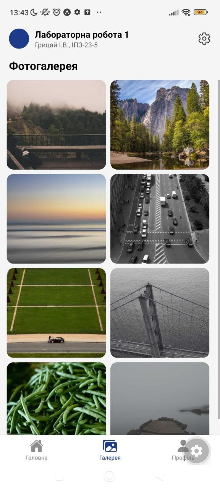
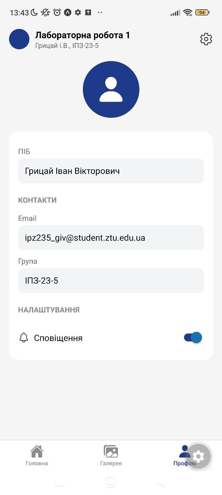

# Лабораторна робота №1: Expo та React Native

**Тема:** Використання Expo для створення найпростішого додатку React Native. Знайомство з основними компонентами.

**Виконав:** Грицай І.В., група ІПЗ-23-5

## Опис проєкту

Мобільний застосунок на React Native з навігацією через нижню панель вкладок (Bottom Tabs). Застосунок складається з трьох екранів:

| Екран | Файл | Опис |
|-------|------|------|
| Головна | `src/app/index.tsx` | Шапка з назвою лабораторної, поле пошуку та стрічка новин у вигляді карток із зображенням, заголовком, датою й текстом |
| Галерея | `src/app/gallery.tsx` | Фотогалерея у вигляді сітки з двох колонок |
| Профіль | `src/app/profile.tsx` | Дані користувача (ПІБ, email, група) та перемикач сповіщень |

Навігація налаштована у файлі `src/app/_layout.tsx` (компонент `Tabs` із Expo Router, іконки з `@expo/vector-icons`).

### Використані технології та компоненти

- **Expo** та **Expo Router** (файлова маршрутизація, вкладки `Tabs`)
- **React Native**: `View`, `Text`, `Image`, `ScrollView`, `TextInput`, `Switch`
- **StyleSheet API** та **Flexbox** для верстки
- **@expo/vector-icons** (Ionicons) для іконок
- **TypeScript**
- Хук `useState` для стану перемикача в профілі

### Структура проєкту

```
lab1/
├── assets/            # зображення та іконки
├── src/
│   └── app/
│       ├── _layout.tsx   # нижня навігація (Tabs)
│       ├── index.tsx     # Головна
│       ├── gallery.tsx   # Галерея
│       └── profile.tsx   # Профіль
├── app.json
├── package.json
└── tsconfig.json
```

## Інструкція із запуску

### Вимоги

- [Node.js](https://nodejs.org/) (рекомендована LTS-версія) та npm
- Для фізичного пристрою: застосунок **Expo Go** (Google Play / App Store)
- Для емулятора: [Android Studio](https://developer.android.com/studio) з налаштованим Android Virtual Device (AVD)

### Кроки

1. Клонувати репозиторій та перейти в папку проєкту:
   ```bash
   git clone <https://github.com/yumetsu123/MobileLabsRN2026>
   cd MobileLabsRN2026/lab1
   ```
2. Встановити залежності:
   ```bash
   npm install
   ```
3. Запустити сервер розробки:
   ```bash
   npx expo start
   ```
4. Відкрити застосунок:
   - **на телефоні:** відсканувати QR-код у застосунку Expo Go (телефон і комп'ютер мають бути в одній Wi-Fi мережі);
   - **в емуляторі Android:** запустити AVD і натиснути `a` у терміналі (або виконати `npx expo start --android`).

## Скріншоти

### Головна


### Галерея



### Профіль



## Способи запуску мобільного додатка

| Спосіб | Команда / дія | Призначення | Особливості |
|--------|---------------|-------------|-------------|
| Стандартний запуск | `npx expo start` | Запуск сервера розробки (Metro Bundler) для щоденної роботи | Показує QR-код і меню команд; підтримує Fast Refresh, тобто зміни в коді відображаються одразу |
| Запуск з очищенням кешу | `npx expo start --clear` | Усунення збоїв, коли не оновлюються стилі, залежності чи нові файли | Перший запуск довший, бо Metro перебудовує кеш; корисно після зміни структури файлів або встановлення пакетів |
| Запуск в емуляторі Android | `npx expo start --android` або `a` у терміналі | Тестування на віртуальному пристрої без фізичного телефону | Потрібен Android Studio та AVD; зручно перевіряти різні розміри екранів і версії Android, але емулятор вимогливий до ресурсів ПК |
| Запуск на фізичному пристрої (Expo Go) | Сканування QR-коду | Перевірка на реальному телефоні: жести, продуктивність, реальні розміри екрана | Телефон і ПК мають бути в одній мережі; не потребує збирання нативного застосунку |
| Тунельне з'єднання | `npx expo start --tunnel` | Підключення, коли телефон і ПК у різних мережах або Wi-Fi блокує локальні з'єднання | Працює через зовнішній тунель, тому повільніший і залежить від інтернету; допомагає за проблем із брандмауером чи мережею університету |
| Веб-версія | `w` у терміналі | Швидка перевірка верстки в браузері | Не відображає поведінку нативних компонентів так, як на пристрої; можливі відмінності у шрифтах, іконках і жестах |

### Відмінності між емулятором і реальним пристроєм

- **Емулятор** зручний для швидкої перевірки та тестування на різних конфігураціях, не потребує USB чи мережі, але не передає реальну продуктивність, сенсорне керування та особливості конкретного виробника.
- **Реальний пристрій** дає точне уявлення про швидкодію, плавність прокрутки, поведінку клавіатури та розміри елементів, але вимагає однієї мережі з комп'ютером (або режиму `--tunnel`).

## Висновки

У ході лабораторної роботи було створено проєкт за допомогою `create-expo-app`, налаштовано середовище розробки та реалізовано триекранний застосунок на React Native з нижньою навігацією через Expo Router. Верстку виконано за допомогою вбудованого `StyleSheet API` та системи Flexbox, а для іконок використано бібліотеку `@expo/vector-icons`.

Було опановано базові компоненти React Native (`View`, `Text`, `Image`, `ScrollView`, `TextInput`, `Switch`) та роботу з локальним станом через `useState`. Також засвоєно принцип файлової маршрутизації Expo Router: екрани мають розміщуватися в папці `src/app`, інакше маршрути не будуть створені.

Порівняння способів запуску показало, що для щоденної розробки найзручніше поєднувати `npx expo start` з Expo Go на фізичному пристрої, використовувати `--clear` у разі збоїв кешу, емулятор Android для перевірки різних конфігурацій екрана, а `--tunnel` для випадків, коли пристрої перебувають у різних мережах. Веб-версія підходить лише для швидкої перевірки верстки.
